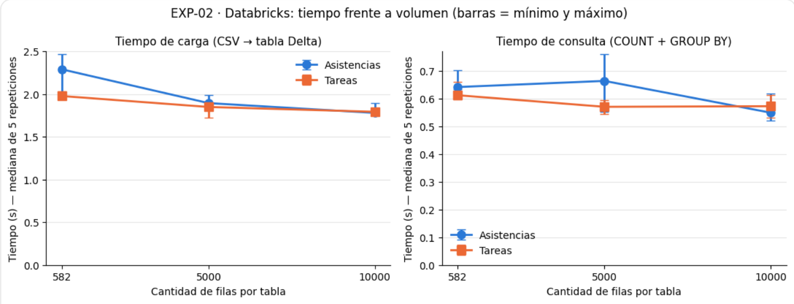

# EXP-02 · Escalabilidad por volumen de datos en Databricks

**Responsable:** Luis Obregón Hidalgo · Proyecto BASAV · Grupo 2 · UPN
**Tipo de experimento:** escalabilidad. Se aumenta progresivamente el volumen de datos y se mide cómo responde la solución (primera alternativa del enunciado de la entrega final).
**Fecha de ejecución:** 21/11/2026 · Databricks Free Edition (serverless)
**Evidencias en el informe:** E-08 y E-14 (puntos 4.1, 4.5, 5.3, 6.2–6.5 y 7.2)

> ¿Nunca usaste Databricks? Sigue la [guía de ejecución paso a paso](GUIA_EJECUCION_EXPERIMENTACION.md).

---

## 1. Objetivo

Medir cómo cambian el **tiempo de carga** (CSV → tabla Delta) y el **tiempo de consulta** (`GROUP BY`) en Databricks cuando el conjunto de asistencias y tareas crece de 582 a 5 000 y a 10 000 filas por tabla, y comprobar que los indicadores de la escala base coinciden con Power BI.

**Pregunta:** ¿cómo cambian los tiempos de carga y de consulta en Databricks al aumentar el volumen de datos de 582 a 10 000 filas por tabla?

**Enfoque:** descriptivo, sin hipótesis direccional (no había una línea base previa de rendimiento en Databricks). Antes de medir se fijaron dos criterios de validez: (1) los KPI de la escala base deben ser iguales a los de Power BI y (2) cada medición se repite 5 veces después de un calentamiento.

## 2. Escenarios comparados

| Escenario | Asistencias | Tareas | Origen |
|---|---:|---:|---|
| Base | 582 | 582 | Datos del Data Mart (10 trabajadores, jul–sep 2026) |
| 5 000 | 5 000 | 5 000 | Sintéticos, semilla 2026 |
| 10 000 | 10 000 | 10 000 | Sintéticos, semilla 2026 (contiene a la de 5 000) |

## 3. Variables y métricas

| Tipo | Variable |
|---|---|
| Independiente | Número de filas por tabla (582, 5 000, 10 000) |
| Dependientes | Tiempo de carga (s) y tiempo de consulta (s): mediana, mínimo y máximo de 5 repeticiones |
| Control | KPI TPA, ICT, TDT e IEP de cada escala |
| Constantes | Mismo notebook, mismo compute serverless, mismas consultas y misma estructura de columnas |

## 4. Procedimiento

1. Crear el esquema `bd_rendimiento`, el volumen `vol_rendimiento` y las carpetas `datos_base` y `resultados`.
2. Copiar los 6 CSV de [`archivos-csv/`](archivos-csv) al volumen y verificar su huella SHA-256 contra el manifiesto.
3. Leer los CSV como DataFrames de Spark con esquema explícito y guardarlos como tablas Delta.
4. Calcular los KPI de la escala base y compararlos con Power BI.
5. Para cada escala y cada tabla: **carga** = leer el CSV + `saveAsTable` (overwrite); **consulta** = `COUNT(*) … GROUP BY` + `collect()`.
6. Cada combinación se ejecuta 1 vez de calentamiento (no se cuenta) y 5 veces medidas con `time.perf_counter`: 12 combinaciones × 6 = **72 mediciones**.
7. Guardar los tiempos, el resumen, el registro de ejecuciones y el gráfico en [`resultados/`](resultados).

Todo está automatizado en [`notebook/EXP02_Databricks_Rendimiento.ipynb`](notebook/EXP02_Databricks_Rendimiento.ipynb).

## 5. Condiciones de prueba

Databricks Free Edition · compute **serverless** (no se puede elegir tamaño) · Spark 4.2.0 · runtime `client.6.6` · Python 3.12.3 (captura D-09). Las escalas se ejecutaron en el mismo orden (582 → 5 000 → 10 000).

## 6. Resultados

| Escala | Operación | Mediana (s) | Mín. (s) | Máx. (s) |
|---:|---|---:|---:|---:|
| 582 | carga asistencias | 2,2914 | 1,9490 | 2,4674 |
| 582 | carga tareas | 1,9786 | 1,9591 | 2,0347 |
| 582 | consulta asistencias | 0,6419 | 0,6342 | 0,7030 |
| 582 | consulta tareas | 0,6124 | 0,5985 | 0,6598 |
| 5 000 | carga asistencias | 1,8955 | 1,8466 | 1,9905 |
| 5 000 | carga tareas | 1,8502 | 1,7227 | 1,8953 |
| 5 000 | consulta asistencias | 0,6640 | 0,5523 | 0,7596 |
| 5 000 | consulta tareas | 0,5706 | 0,5450 | 0,5959 |
| 10 000 | carga asistencias | 1,7807 | 1,7494 | 1,8952 |
| 10 000 | carga tareas | 1,7938 | 1,7505 | 1,8287 |
| 10 000 | consulta asistencias | 0,5493 | 0,5199 | 0,6180 |
| 10 000 | consulta tareas | 0,5727 | 0,5312 | 0,6118 |

**KPI por escala** (`resultados/kpi_por_escala.csv`, TPA / ICT / TDT / IEP): base 92,10 / 56,36 / 3,44 / 75,12 (**igual a Power BI**) · 5 000: 94,52 / 57,10 / 2,90 / 76,33 · 10 000: 92,82 / 55,97 / 3,65 / 75,10.



## 7. Comparación e interpretación

- Al pasar de 582 a 10 000 filas **los tiempos no aumentaron**: la carga se mantuvo entre 1,78 y 2,29 s y la consulta entre 0,55 y 0,66 s.
- En este rango pesa más el **costo fijo** de cada operación en Spark (planificar y arrancar el trabajo) que la cantidad de datos.
- El calentamiento fue más lento que la mediana en 9 de las 12 combinaciones, por eso se excluye del resumen.
- No se puede extrapolar a millones de filas: no se midió fuera del rango 582–10 000 ni se probaron particionamiento o tamaños de compute.

## 8. Conclusión

Con hasta 10 000 filas por tabla, Databricks carga y consulta los datos del proyecto en menos de 2,3 s y 0,7 s, sin degradación al crecer el volumen, y calcula los mismos KPI que Power BI. La solución tiene margen para crecer en este rango; para afirmar escalabilidad a mayor volumen hay que repetir el experimento con 10⁵–10⁶ filas y orden aleatorio de escalas.

## 9. Evidencias

El significado de cada captura y de cada gráfico está en [`capturas/README.md`](capturas/README.md).

| Captura | Contenido |
|---|---|
| D-01 … D-04 | Esquema, volumen, CSV con SHA-256, primeras líneas y DataFrames |
| D-05, D-05b | Asistencias por mes y estado (tabla y gráfico) |
| D-06, D-07 | Tablas Delta y `GROUP BY` con KPI de la base |
| D-08, D-08b | Escalas de 5 000 y 10 000 filas |
| D-09 | Entorno de ejecución |
| T-01 … T-03 | Mediciones, registro RUN-03 a RUN-05, KPI por escala y gráfico tiempo vs. filas |

## 10. Contenido de esta carpeta

| Carpeta | Archivo | Uso |
|---|---|---|
| `archivos-csv/` | `asistencias_*.csv`, `tareas_*.csv` | Escala base y escalas sintéticas cargadas en Databricks (solo IDs). |
| `archivos-csv/` | `manifiesto_datos.csv` / `.json` | Filas, bytes, SHA-256, semilla y KPI de cada archivo. |
| `notebook/` | `EXP02_Databricks_Rendimiento.ipynb` | Notebook del experimento (crea el esquema, copia los CSV, mide y grafica). |
| `resultados/` | `tiempos_databricks.csv`, `resumen_tiempos.csv`, `registro_ejecuciones.csv`, `kpi_por_escala.csv`, `grafico_tiempos.png` | Salidas de la ejecución. |
| `capturas/` | `D-01` … `D-09`, `T-01` … `T-03` | Evidencias con fecha y celda visibles. |
| `scripts/` | `exportar_base.sql` | Exportar `Asistencia` y `Tareas` de A&SG_OLTP desde SSMS (solo IDs). |
| `scripts/` | `reconstruir_base_desde_repo.py` | Reconstruye las 582 + 582 filas sin SQL Server, con la lógica de `01_Base_Datos`. |
| `scripts/` | `generar_sinteticos.py` | Genera las escalas de 5 000 y 10 000 filas (semilla 2026) y el manifiesto. |

### Regenerar los datos (opcional)

```bash
cd 06_Big_Data_Databricks/exp02-Escalabilidad/scripts
python reconstruir_base_desde_repo.py --salida export        # o exportar con exportar_base.sql
python generar_sinteticos.py --asistencia export/Asistencia.csv --tareas export/Tareas.csv --salida ../archivos-csv
```

### Origen de los datos

- **Base (582 + 582):** replica el generador T-SQL del repositorio. Coincide con 203/186/193 asistencias por mes, 15/15/16 tardanzas y los KPI globales de Power BI. Solo difiere el minuto exacto de entrada (CHECKSUM en T-SQL, CRC32 en el script), dentro del mismo rango, sin cambiar estados ni KPI.
- **Escalas sintéticas:** cada trabajador sintético (ID desde 1001) copia las fechas y tareas de un trabajador base elegido con la semilla; la entrada varía ±5 min. Se mantienen la regla de las 09:41 y los estados. Sin nombres, correos, teléfonos ni PIN.
- Scripts y notebook elaborados con ayuda de IA (Claude) y verificados por el grupo (punto 5.7 del informe).
