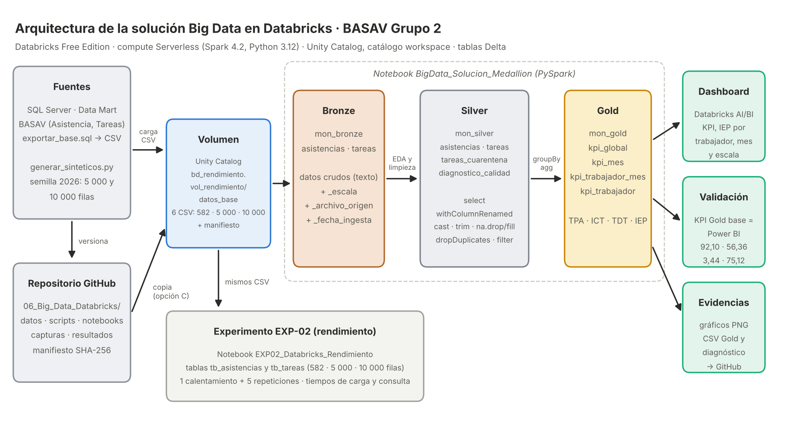

# Guía de replicación · Solución Big Data en Databricks (Medallion)

Esta guía permite que cualquier integrante o el docente repita la solución Big Data desde cero, con una cuenta gratuita.
Tiempo aproximado: 15 minutos. No hace falta SQL Server: los CSV ya están en [`../datos`](../datos).



## 1. Requisitos

| Requisito | Detalle |
|---|---|
| Cuenta | Databricks **Free Edition** (<https://www.databricks.com/learn/free-edition>), inicio de sesión con Google o correo. |
| Compute | **Serverless**, el único disponible en Free Edition. No hay que crear clúster. |
| Catálogo | `workspace` (viene creado). El notebook crea los esquemas `mon_bronze`, `mon_silver`, `mon_gold` y usa el volumen `bd_rendimiento.vol_rendimiento`. |
| Archivos | [`BigData_Solucion_Medallion.ipynb`](BigData_Solucion_Medallion.ipynb) y los 6 CSV de [`../datos`](../datos). |

## 2. Subir los datos al volumen

**Opción A (recomendada, automática).** No hacer nada: la sección 1 del notebook descarga los 6 CSV desde GitHub si no están en el volumen.

**Opción B (manual).**
1. En la barra izquierda: **Catalog** (catálogo) → `workspace` → **Create** (crear) → **Schema** (esquema) → nombre `bd_rendimiento`.
2. Dentro de `bd_rendimiento`: **Create** → **Volume** (volumen) → nombre `vol_rendimiento`.
3. Abrir el volumen → **Create directory** (crear carpeta) → `datos_base`.
4. Entrar a `datos_base` → **Upload to this volume** (subir a este volumen) → seleccionar
   `asistencias_base.csv`, `tareas_base.csv`, `asistencias_5000.csv`, `tareas_5000.csv`, `asistencias_10000.csv`, `tareas_10000.csv`.

## 3. Importar el notebook

1. **Workspace** (espacio de trabajo) → carpeta de tu usuario → menú **⋮** → **Import** (importar).
2. Elegir **File** (archivo) y arrastrar `BigData_Solucion_Medallion.ipynb` → **Import**.

## 4. Ejecutar

1. Abrir el notebook. Arriba a la derecha, en **Connect** (conectar), elegir **Serverless**.
2. Pulsar **Run all** (ejecutar todo). Si sale *Attached cluster is terminated*, ir a **Select resource** (elegir recurso) →
   **General compute** → **Serverless** → **Start, attach and run** (iniciar, conectar y ejecutar).
3. Esperar a que terminen las 14 celdas de código (2–4 minutos).

## 5. Qué debe aparecer (comprobación)

| Celda / captura | Resultado esperado |
|---|---|
| S-01 | Esquemas `mon_bronze`, `mon_silver`, `mon_gold`. |
| S-02 | Bronze con 582, 5 000 y 10 000 filas por tabla y el archivo de origen de cada una. |
| S-03 / S-04 | `describe`, `summary`, nulos por columna y distribuciones (estado, mes, hora de entrada, trabajador). |
| S-05 | Tabla de reglas de calidad con las filas que incumplen cada una, por escala. |
| S-06 | Esquema Silver con columnas renombradas en minúscula y tipadas. |
| S-07 | Conciliación Bronze ↔ Silver (filas descartadas) y tareas en cuarentena. |
| S-08 | Tablas Gold `kpi_global`, `kpi_mes`, `kpi_trabajador_mes`, `kpi_trabajador`. |
| S-09 | **TPA 92,10 · ICT 56,36 · TDT 3,44 · IEP 75,12** en la escala base y la línea `TODOS COINCIDEN` (igual a Power BI). |
| S-10 | Cuatro gráficos: KPI por mes, IEP por trabajador, hora de entrada, KPI por escala. |
| S-11 | Inventario de tablas Delta con filas, bytes y comentario; historial Delta. |
| S-12 | Enlace al dashboard **"BASAV · Monitoreo de empleados (Gold)"**. Abrirlo desde **Dashboards**. |

Si en S-09 aparece `HAY DIFERENCIAS`, revisar que los CSV sean los del repositorio (SHA-256 en `../datos/manifiesto_datos.csv`).

## 6. Dashboard

La sección 10 del notebook crea y publica el dashboard con el SDK de Databricks. Si falla (por ejemplo, porque el SQL warehouse está apagado):
1. **SQL Warehouses** → iniciar **Serverless Starter Warehouse**.
2. Volver a ejecutar solo la celda de la sección 10, o crearlo a mano: **Dashboards** → **Create dashboard** (crear dashboard) →
   pestaña **Data** → **Create from SQL** y pegar las consultas de la lista `datasets` de la sección 10.

## 7. Limpieza (opcional)

```sql
DROP SCHEMA IF EXISTS workspace.mon_bronze CASCADE;
DROP SCHEMA IF EXISTS workspace.mon_silver CASCADE;
DROP SCHEMA IF EXISTS workspace.mon_gold CASCADE;
```

## 8. Límites

- Las escalas de 5 000 y 10 000 filas son sintéticas (semilla 2026); sus KPI no describen a trabajadores reales.
- Free Edition no permite elegir tamaño de compute ni ver Spark UI; no se probaron particionamiento, streaming ni tolerancia a fallos.
- Solo se usan IDs de trabajador; no se exportan nombres, correos, teléfonos ni PIN.
